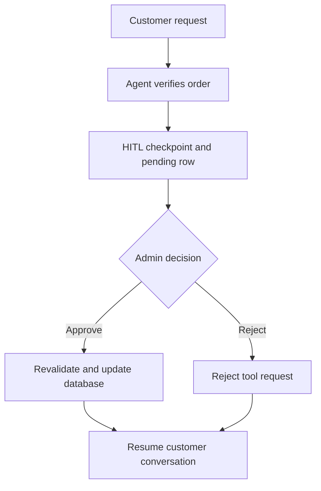

# E-Commerce Customer Support Agent

A Streamlit customer-support application built with LangChain 1.x and LangGraph. It answers policy questions from local documents, queries the authenticated customer's e-commerce records, and pauses cancellation/return actions until an administrator approves or rejects them. MCP is not used or required.

## Requirements

- Python 3.13 or newer, as specified in `pyproject.toml`.
- `uv` installed and available in your terminal.
- An OpenAI API key with access to `gpt-4.1-mini` and `text-embedding-3-small`.
- Optional Gmail Desktop OAuth credentials for email notifications.

Dependencies and their resolved versions are recorded in `pyproject.toml` and `uv.lock`. Recreate the environment locally; do not copy the old macOS `.venv` to another computer.

## Fresh setup

From the `langchain-bot` directory:

```bash
uv sync
cp .env.example .env
```

Edit `.env`:

```dotenv
OPENAI_API_KEY=your-openai-api-key
CHECKPOINTS_DB_PATH=checkpoints.sqlite
```

Create the demo business database once:

```bash
uv run python -m langchain_bot.db_init
```

The seed creates demo users, products, orders, payments, returns, tickets, pending actions, and email logs. The initializer refuses to overwrite an existing database. After making a backup, an intentional demo reset is available with `uv run python -m langchain_bot.db_init --reset`; this deletes existing business records.

## Run both applications

Run the customer app in one terminal:

```bash
uv run streamlit run app.py --server.port 8501
```

Run the admin console in a second terminal from the same project:

```bash
uv run streamlit run app_admin.py --server.port 8502
```

Open the customer app at http://localhost:8501 and the admin console at http://localhost:8502. The root launch files import the installed `langchain_bot` package.

## Demo accounts

These are classroom demonstration credentials from the SQL seed.

| Role | Email | Password |
| --- | --- | --- |
| Customer | sivaprasad.valluru@gmail.com | siva@123 |
| Customer | bob@example.com | bob123 |
| Customer | charlie@example.com | charlie123 |
| Admin | admin@example.com | admin123 |
! Customer| codeforself123@gmail.com|codeforself123

## Customer and admin workflow

1. Log in as a customer. Ask “What is your returns policy?” to exercise RAG, or “Show my orders” to exercise SQL.
2. Ask to cancel order **13** as Siva. Its seeded status is `PLACED`.
3. The graph pauses before the action runs. The request appears in the admin console and customer input is disabled for that thread.
4. Log in as the administrator and approve or reject the request.
5. Approval resumes the same customer graph thread, revalidates ownership/status, and updates the database. Rejection leaves the order unchanged.
6. Refresh the customer browser to load the updated checkpoint and continue chatting. You may start a separate conversation while another thread is pending.

For a return, ask for the products in Siva's order **10**, then request a return with the **exact product name** and a reason. Order 10 is seeded as `SHIPPED`. A return on `PLACED` order 13 is rejected; cancellation is the appropriate operation.



## Project layout

| Path | Purpose |
| --- | --- |
| `app.py`, `app_admin.py` | Root Streamlit launch files |
| `src/langchain_bot/app.py` | Customer login, threads, chat, and pending-request UI |
| `src/langchain_bot/app_admin.py` | Admin login and approval/rejection dashboard |
| `src/langchain_bot/agent.py` | Main agent, identity prompt, HITL middleware, checkpointer |
| `src/langchain_bot/context.py` | Typed runtime customer context |
| `src/langchain_bot/settings.py` | Project-root `.env` and checkpoint path resolution |
| `src/langchain_bot/auth.py` | Parameterized demo login query |
| `src/langchain_bot/sql_tools.py` | Customer-scoped, read-only SQL tools and toolkit query checker |
| `src/langchain_bot/action_tools.py` | Approved cancellation and return database transactions |
| `src/langchain_bot/hitl_utils.py` | Validate/persist interruptions and resume decisions |
| `src/langchain_bot/rag_tools.py` | Chroma policy retrieval and document splitting |
| `src/langchain_bot/gmail_tools.py` | Optional Gmail OAuth and send-message tool |
| `src/langchain_bot/middleware.py` | Model and tool logging |
| `src/langchain_bot/db_init.py` | Guarded demo initialization/reset |
| `src/langchain_bot/data/policies/` | Three policy/FAQ text documents |
| `ecommerce_setup.sql` | Business schema and demo seed |
| `tests/` | Database, approval, and SQL isolation regressions |

Runtime files are generated locally: `ecommerce.db`, `checkpoints.sqlite`, `chat_threads.json`, and `chroma_db/`. The Chroma index is created on first use with OpenAI embeddings. After editing policy documents, stop both apps and remove or rename `chroma_db/` to rebuild the index.

Chat messages come from LangGraph checkpoints. `chat_threads.json` contains conversation IDs and titles only. The fresh SQL seed does not create chat transcript tables.

## Updating an existing installation

Stop both apps and back up the project, `ecommerce.db`, checkpoint files, and thread metadata. Copy the corrected source, launch files, configuration, tests, and README into your project, retaining your `.env`, credentials, runtime data, and policy customizations. Run `uv sync`. Do not run the seed initializer against business data you want to keep.

Legacy `pending_actions` status constraints are migrated when the pending-action helpers run; existing rows are retained and the `FAILED` status becomes available.

The old implementation could place `checkpoints.sqlite` inside `src/langchain_bot/` because paths were relative to the launch directory. Both corrected apps resolve relative checkpoint paths against the project root. To keep an existing checkpoint in that old location, use:

```dotenv
CHECKPOINTS_DB_PATH=src/langchain_bot/checkpoints.sqlite
```

Alternatively, with both apps stopped, copy it to the root using SQLite's backup API, which includes committed WAL data:

```bash
uv run python - <<'PY'
import sqlite3
from pathlib import Path
source = Path('src/langchain_bot/checkpoints.sqlite')
destination = Path('checkpoints.sqlite')
if not source.exists() or destination.exists():
    raise SystemExit('Source must exist and destination must not already exist.')
with sqlite3.connect(source) as old, sqlite3.connect(destination) as new:
    old.backup(new)
PY
```

Keep the `chat_threads.json` corresponding to that checkpoint at the project root. Do not mix unrelated checkpoint files or thread lists. The corrected archive contains source only, so it does not overwrite your private runtime files.

## Optional Gmail

Create a Google Cloud project, enable Gmail API, configure the OAuth consent screen, and add the Gmail account as a test user while the app is in testing. Create a **Desktop app** OAuth client and place its downloaded JSON at the project root as `credentials.json`.

The app requests the `gmail.send` scope and caches the generated OAuth token at `token.pickle` (the dependency controls its serialization). Only the send-message tool is exposed. If credentials are missing or OAuth fails, the application continues without Gmail. Restart both apps after changing credentials or completing configuration.

If Google shows “Access blocked” for an unverified testing application, check that the signing-in account is a configured test user. Emails are requested by the agent after successful database actions; verify the Gmail tool's success before assuming an email was sent.

## Verification

After installing dependencies:

```bash
uv run python -m unittest discover -s tests -v
uv run python -m compileall -q src app.py app_admin.py tests
```

The 13 regressions cover owned-order cancellation, cross-customer rejection, valid/invalid returns, duplicate returns, pending-action schema migration, invalid interrupts, approval/rejection, context preservation, stale success-message handling, customer SQL isolation, and denied writes/database escapes.

Validation during this repair: all 13 tests passed against temporary, real SQLite databases. SQL checks used the SQLAlchemy and SQLDatabase source included in the uploaded environment. LangChain decorators/runtime imports and graph invocation were stubbed or mocked because the complete dependencies were not installed in the repair environment. Syntax compilation also passed. Live Streamlit, OpenAI inference/embeddings, Gmail OAuth, and an actual LangGraph interrupt/resume integration were not exercised. Run the commands above and the customer/admin workflow on your machine for integration validation.

## Corrections made

| Original failure | Correction |
| --- | --- |
| Queries used nonexistent `orders.order_id` and `orders.user_email` | Use `orders.id` and join ownership through `users.id`/`orders.user_id` |
| Return/ticket inserts used nonexistent fields and omitted required fields | Use real order-item/user IDs, required timestamps, ticket subject and thread ID |
| Pending action names violated `CANCEL_ORDER`/`CREATE_RETURN` constraints | Translate tool names to business action values |
| Failed approvals could not use `FAILED` under the old status constraint | Preserve rows while migrating that constraint |
| Admin resume passed a dictionary to tools expecting a dataclass | Resume with `SessionContext` and the original customer identity |
| Old successful tool messages could incorrectly imply a new action succeeded | Evaluate newly generated action messages |
| Bare imports broke package imports | Use `langchain_bot` imports and root launch files |
| Checkpoint paths depended on the launch directory | Resolve against a shared project root |
| SQL toolkit could reach unfiltered data or mutate business tables | Provide isolated customer snapshots with a read-only SQLite authorizer |
| Gmail toolkit exposed operations beyond the send-only scope | Expose only Gmail send-message |
| Model middleware read the response wrapper as if it were an AI message | Read the contained response message |

## Troubleshooting and limits

- **Module import fails:** run `uv sync` from the project root and use `uv run` for commands.
- **Missing API key:** set `OPENAI_API_KEY` in the root `.env` and restart both processes.
- **Order not found:** check ownership; Siva does not own Bob's order 11.
- **Admin sees no request:** ensure both apps use the same project/database/checkpoint path; inspect customer terminal errors.
- **Thread remains pending:** refresh after the admin decision. A pending graph blocks further customer input to avoid unmatched tool-call messages.
- **Approval fails:** inspect both terminal logs and the `FAILED` admin filter. If a model/email error occurs after a committed database action, inspect the business data before retrying; the graph and business database are separate transactions.
- **Demo-only authentication:** passwords in the seed are plaintext. Production requires password hashing and stronger access/session management.
- **Refund semantics:** this assignment marks the entire order payment `REFUNDED`, including when one item is returned. It does not call a payment gateway or implement partial refunds. Return rows created after approval use `APPROVED`; the approving administrator ID is not captured in runtime context.
- **Deployment:** this is a local capstone, not a multi-worker production service. SQLite/checkpoint concurrency, atomic thread metadata updates, idempotent cross-process approval, and guaranteed email delivery need additional engineering for production.

Keep `.env`, OAuth credentials/tokens, databases, checkpoints, and the virtual environment out of version control. These files are excluded by `.gitignore` and from the corrected archive.
